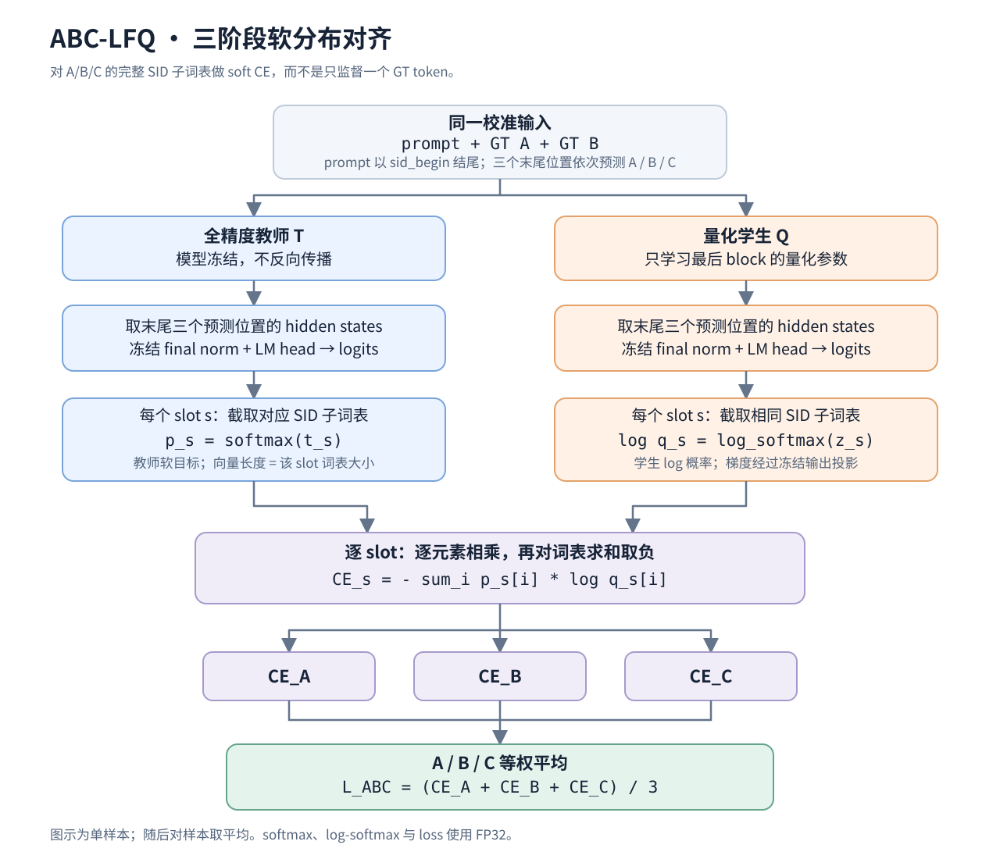
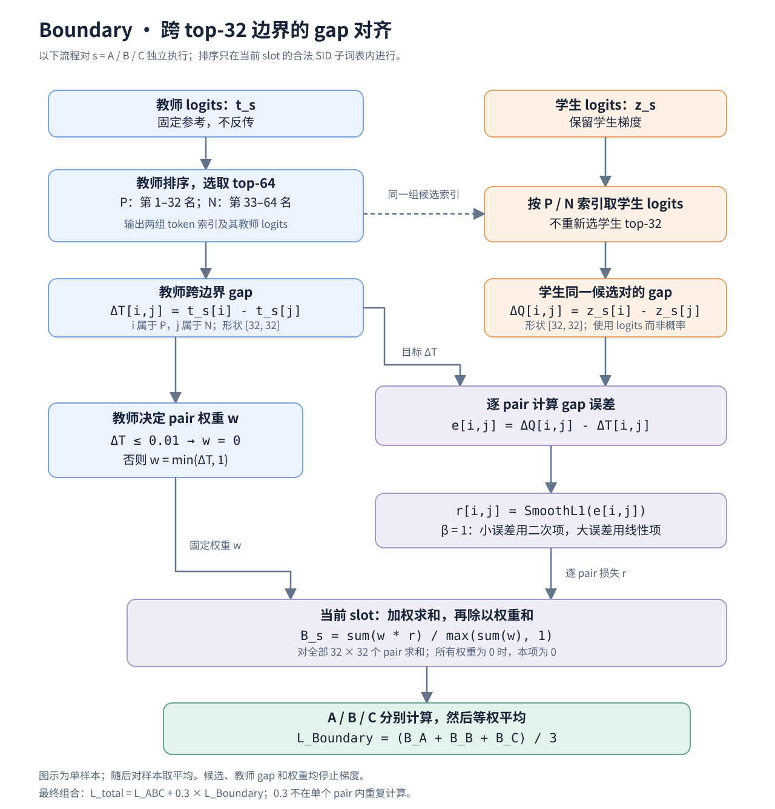

# ABC-LFQ + 0.3 × Boundary：对齐损失

本文对应当前采用的复合配置，公式与现有实现一致。先定义单条样本的损失；训练时对样本取平均。

## 1. 总目标

$$
\boxed{
\mathcal L
=\mathcal L_{\mathrm{ABC}}+0.3\,\mathcal L_{\mathrm{Boundary}}
=\frac{1}{3}\sum_{s\in\{A,B,C\}}
\left(\mathcal L_{\mathrm{CE}}^s+0.3\,\mathcal L_{\mathrm{bd}}^s\right)
}
$$

A/B/C 等权。ABC-LFQ 对齐各阶段的整体候选分布；Boundary 额外强调 top-32 的跨边界分数差距。系数 0.3 是损失权重，不表示 Boundary 占总损失或梯度的 30%。

## 2. ABC-LFQ：软分布对齐

蓝色为冻结教师分支，橙色为学生分支。图中流程对三个 slot 分别执行，再等权平均。

令 $t^s$、$z^s$ 分别为全精度教师和量化学生在阶段 $s$ 的 logits，$\mathcal V_s$ 为该阶段的合法 SID 子词表：

$$
p^s=\operatorname{softmax}(t^s),\qquad
q^s=\operatorname{softmax}(z^s),
\qquad
\mathcal L_{\mathrm{CE}}^s
=-\sum_{i\in\mathcal V_s}p_i^s\log q_i^s.
$$

softmax 仅在对应 slot 子词表内计算，温度为 1。教师分布固定，因此优化该 soft CE 与优化 $\mathrm{KL}(p^s\Vert q^s)$ 等价；它不是 GT token 的 one-hot CE。

## 3. Boundary：跨 top-32 边界的差距对齐

虚线传递教师选出的候选索引；学生不自行重新筛选候选。权重和教师 gap 均不反传。

对每个阶段，按照**教师 logits** 排序：

- $\mathcal P_s$：第 1–32 名候选；
- $\mathcal N_s$：第 33–64 名候选。

对每个 $i\in\mathcal P_s$、$j\in\mathcal N_s$，定义教师和学生的 logit 差距：

$$
\Delta_{ij}^{T,s}=t_i^s-t_j^s,\qquad
\Delta_{ij}^{Q,s}=z_i^s-z_j^s.
$$

采用当前的 tie 阈值 0.01、gap 权重尺度 1.0：

$$
w_{ij}^s
=\mathbf 1\!\left[\Delta_{ij}^{T,s}>0.01\right]
\min\!\left(\Delta_{ij}^{T,s},\,1\right).
$$

教师近似并列的 pair 被跳过；其余 pair 的权重随教师 gap 增大，最大为 1。候选、教师 gap 和权重均固定，不参与反向传播。

每个阶段的 Boundary loss 为：

$$
\mathcal L_{\mathrm{bd}}^s
=
\frac{
\displaystyle\sum_{i\in\mathcal P_s,\,j\in\mathcal N_s}
w_{ij}^s\,\rho\!\left(\Delta_{ij}^{Q,s}-\Delta_{ij}^{T,s}\right)
}{
\displaystyle\max\!\left(
\sum_{i\in\mathcal P_s,\,j\in\mathcal N_s}w_{ij}^s,\,1
\right)
},
\qquad
\rho(e)=
\begin{cases}
\frac12 e^2,& |e|<1,\\
|e|-\frac12,& |e|\ge1.
\end{cases}
$$

$\rho$ 即默认 SmoothL1。每个阶段最多构造 $32\times32$ 个 pair；若全部被过滤，该阶段 Boundary loss 为 0。

这不仅要求学生保持正负候选的顺序，还要求其**分数差距接近教师**。例如教师 gap 为 0.8，学生 gap 为 0.1：虽然顺序没错，仍会受到惩罚。

## 4. 训练中的含义与范围

校准输入为以 sid_begin 结尾的 prompt，再追加 GT 的 A、B。最后三个位置分别预测 A、B、C：

- A：给定 prompt；
- B：给定 prompt 和 GT A；
- C：给定 prompt 和 GT AB。

GT 用来构造条件前缀；真正的对齐目标由全精度教师提供。当前流程在最后一个 block 优化量化参数，前缀、final norm 和 LM head 冻结；使用 FlatQuant 联合版本时，可学习参数包括矩阵、对角 scale、LWC 和 LAC。

该损失**不包含 hidden-state MSE**，也不直接优化完整 beam 路径或商品 recall。Boundary 不显式约束 top-32 内部的完整排序，也不主动挖掘教师第 64 名以后的学生侵入候选，因此不能保证 top-32 完全保留。

实现对应：[soft CE 与 Boundary 定义](../flat_quant/omniquant/runtime.py)、[FlatQuant 中的目标组合](../flat_quant/flatquant/runtime.py)。
